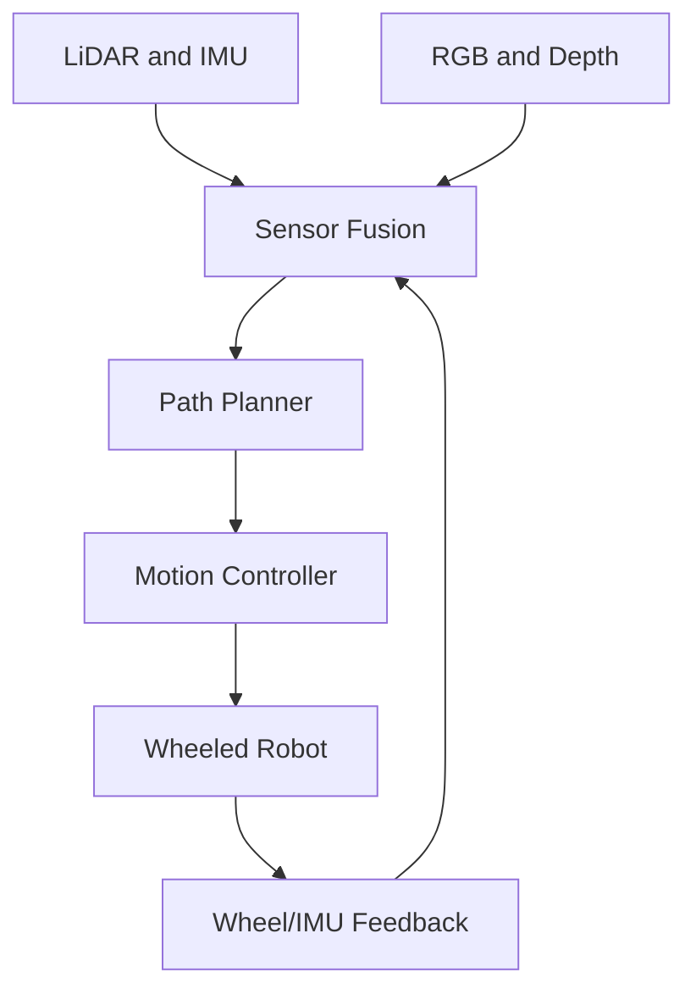

# GitHuber Review Demo

Public, synthetic example content for testing the **GitHuber** iOS repository browser. No private data or credentials are included.

## Explore

- [Robot architecture flowchart](docs/architecture.md)
- [Control mathematics](docs/control_math.md)
- [Local HTML document](docs/index.html)
- [C++ source example](src/motion_control.cpp)
- [Nested troubleshooting guide](docs/guides/debugging.md)

This repository demonstrates Markdown, Mermaid SVG, LaTeX, HTML, links, syntax highlighting, commit selection, and read-only history.

## Mermaid flowchart

## Control equation

$$
u[k] = K_p e[k] + K_i T_s \sum_{j=0}^{k}e[j]
$$

> **Review note:** This demo repository is deliberately public. GitHuber is an independent GitHub client.