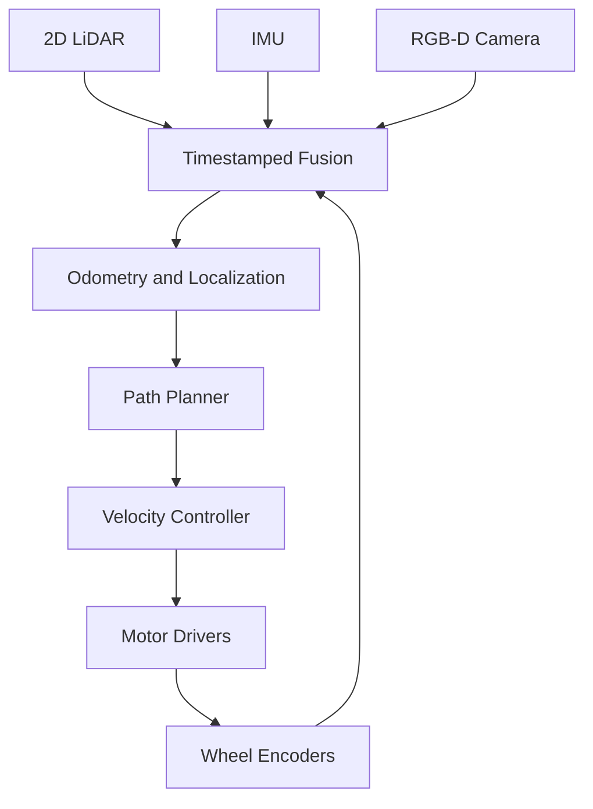

# Mobile Robot Architecture

A synthetic indoor autonomy stack for demonstrating diagram rendering and repository-relative navigation.

## Sensor-to-action pipeline

## Execution ownership

High-rate motor safety and sensor fusion remain on the robot. Operator dashboards receive bounded, time-stamped observations. Temporary camera or LiDAR loss does not reset the remote-control session.

Go to [control equations](control_math.md), [HTML preview](index.html), or [repository home](../README.md).